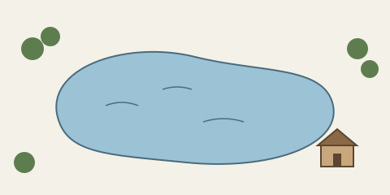

# Contents

- [Where I Lived, and What I Lived For](#where-i-lived)
- [Conclusion](#conclusion)

# Where I Lived, and What I Lived For {#where-i-lived}

We must learn to reawaken and keep ourselves awake, not by mechanical aids, but by an infinite expectation of the dawn, which does not forsake us in our soundest sleep. I know of no more encouraging fact than the unquestionable ability of man to elevate his life by a conscious endeavor. It is something to be able to paint a particular picture, or to carve a statue, and so to make a few objects beautiful; but it is far more glorious to carve and paint the very atmosphere and medium through which we look, which morally we can do. To affect the quality of the day, that is the highest of arts.

I went to the woods because I wished to live deliberately, to front only the essential facts of life, and see if I could not learn what it had to teach, and not, when I came to die, discover that I had not lived. I did not wish to live what was not life, living is so dear; nor did I wish to practise resignation, unless it was quite necessary. For most men, it appears to me, are in a strange uncertainty about it, whether it is of the devil or of God, and have *somewhat hastily* concluded that it is the chief end of man here to "glorify God and enjoy him forever."[^catechism]

Time is but the stream I go a-fishing in. I drink at it; but while I drink I see the sandy bottom and detect how shallow it is. Its thin current slides away, but eternity remains. I would drink deeper; fish in the sky, whose bottom is pebbly with stars. I cannot count one. I know not the first letter of the alphabet.

# Conclusion {#conclusion}

> The light which puts out our eyes is darkness to us. Only that day dawns to which we are awake. There is more day to dawn. The sun is but a morning star.

[^catechism]: Editor's note for this demo: the quoted phrase is the answer to the first question of the Westminster Shorter Catechism (1647).
