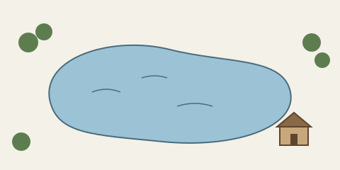

# 目录

- [我生活的地方，我为何而生活](#where-i-lived)
- [结束语](#conclusion)

# 我生活的地方，我为何而生活 {#where-i-lived}

我们必须学会重新醒来，并让自己保持清醒——不是靠机械的帮助，而是靠对黎明无尽的期待，这种期待即便在我们睡得最沉的时候也不会离开我们。我所知道的最令人鼓舞的事实，莫过于人无可置疑地能够凭借自觉的努力提升自己的生活。能画出一幅特定的画、雕出一尊雕像，从而让几样东西变得美，固然了不起；但若能雕琢、描绘我们借以观看的那层气氛与媒介本身，那就光荣得多，而在道德上我们是做得到的。影响一天的品质，这才是最高的艺术。

我到林中去，是因为我希望从容地生活，只面对生活中最本质的事实，看看我能否学到它要教给我的东西，免得到临死时才发现自己从未真正活过。我不愿过不是生活的生活，生活是如此可贵；除非万不得已，我也不愿听天由命。在我看来，大多数人对生活抱着一种奇怪的不确定，不知道它属于魔鬼还是属于上帝，却*有些草率地*断定，人在世间的首要目的就是“荣耀上帝，并永远以他为乐”。[^catechism]

时间不过是我垂钓的溪流。我饮水其中；饮水时，我看见沙质的河底，察觉它多么浅。它细细的水流悄然淌走，永恒却留了下来。我想饮得更深；在天空里垂钓，那天空的底部铺满了星星的卵石。我连一颗也数不出。我连字母表的第一个字母都不认得。

# 结束语 {#conclusion}

> 使我们双目失明的光，对我们来说就是黑暗。只有我们醒着迎接的那一天才会破晓。还有更多的白昼等待破晓。太阳不过是一颗晨星。

[^catechism]: 本演示的编者注：引号中的这句话是《威斯敏斯特小教理问答》（1647）第一问的答案。
